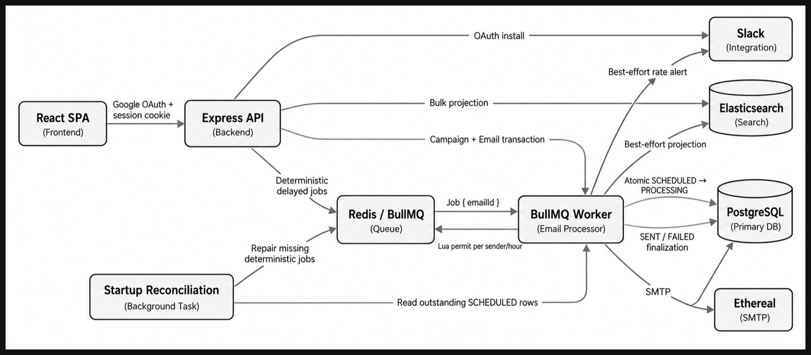
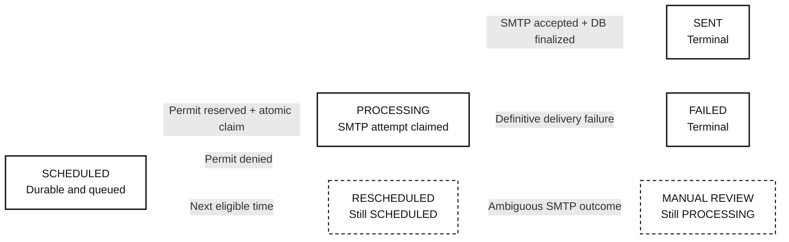
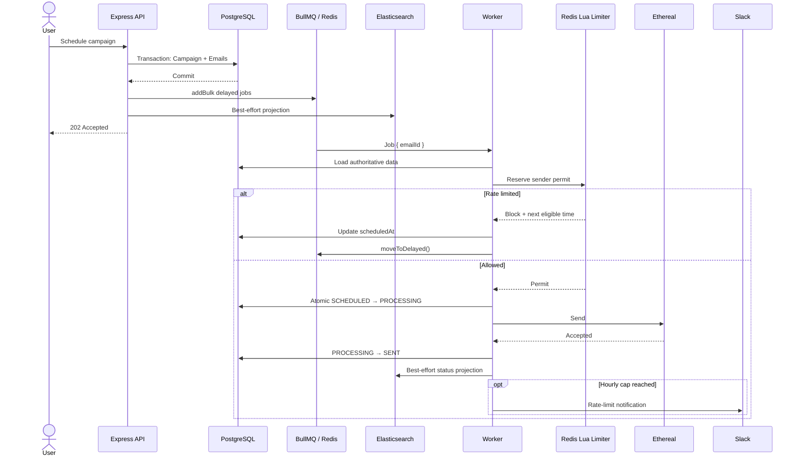

<div align="center">
  <h1>ReachInbox Email Scheduler</h1>
  <p>
    <strong>A full-stack, persistent email scheduling system built for reliable delivery at scale.</strong>
  </p>
  <p>
    Express · BullMQ · PostgreSQL · Redis · Elasticsearch · React · Google OAuth · Slack OAuth · Ethereal SMTP
  </p>
  <p>
    <a href="https://nodejs.org/"></a>
    <a href="https://www.typescriptlang.org/"></a>
    <a href="https://pnpm.io/"></a>
    <a href="https://vitest.dev/"></a>
  </p>
</div>

ReachInbox Email Scheduler is a production-oriented implementation of a distributed email scheduler. An authenticated user can upload a CSV/TXT lead list, choose one of multiple senders, configure a start time, inter-email delay, and hourly limit, then follow each recipient from `SCHEDULED` through delivery.

The project is intentionally more than a CRUD dashboard. It demonstrates durable delayed work, cross-worker coordination, tenant isolation, failure recovery, idempotent request handling, searchable projections, and isolated third-party side effects.

## Table of contents

- [What is implemented](#what-is-implemented)
- [Architecture](#architecture)
- [Scheduling and delivery sequence](#scheduling-and-delivery-sequence)
- [Correctness model](#correctness-model)
- [Technology](#technology)
- [Repository layout](#repository-layout)
- [Getting started](#getting-started)
- [Provider configuration](#provider-configuration)
- [API surface](#api-surface)
- [Operations](#operations)
- [Testing](#testing)
- [Behavior under load](#behavior-under-load)
- [Deployment](#deployment)
- [Trade-offs and known limitations](#trade-offs-and-known-limitations)
- [Demo checklist](#demo-checklist)

## What is implemented

### Required product surface

| Area             | Implementation                                                                                                                   |
| ---------------- | -------------------------------------------------------------------------------------------------------------------------------- |
| Authentication   | Real Google OAuth/OIDC, Redis-backed server sessions, profile display, and logout                                                |
| User interface   | Responsive mail-client-style React UI based on the supplied login, dashboard, Compose, send-later, and detail references         |
| Compose          | Sender selection, CSV/TXT upload, recipient preview/deduplication, subject, plain-text body, start time, delay, and hourly limit |
| Scheduling       | PostgreSQL persistence followed by BullMQ delayed jobs; no cron and no process-local timers                                      |
| Dashboard        | Scheduled/Processing and Sent/Failed lists, totals, cursor pagination, polling, loading/empty/error states, and email detail     |
| Delivery         | Separate configurable-concurrency Worker and two environment-configured Ethereal SMTP identities                                 |
| Rate limiting    | Atomic Redis Lua permit per sender for minimum spacing and fixed UTC-hour quotas                                                 |
| Search           | Elasticsearch-backed, tenant-scoped subject/body/recipient/sender search with status filters                                     |
| Queue visibility | Authenticated Bull Board at `/admin/queues`                                                                                      |
| Slack            | Real OAuth V2 using the minimal `incoming-webhook` scope, connection controls, test notification, and rate-limit alerts          |
| Recovery         | Startup/manual PostgreSQL-to-BullMQ reconciliation and graceful API/Worker shutdown                                              |

### Reliability and security

- Campaign creation is user-scoped and protected by `(userId, idempotencyKey)` uniqueness.
- Identical retries return the original campaign and repair missing jobs; conflicting reuse returns HTTP `409`.
- Every queue job has the deterministic ID `email-<emailUuid>` and contains only `{ emailId }`.
- An atomic PostgreSQL `SCHEDULED -> PROCESSING` update is the authority for an SMTP attempt.
- Throttled work remains `SCHEDULED` and is moved back to BullMQ's delayed set instead of blocking a Worker or being dropped.
- Authentication identity always comes from the server session; request data cannot select another tenant.
- Slack webhook URLs and tokens are encrypted at rest with AES-256-GCM.
- Elasticsearch and Slack are best-effort side effects. Their failure cannot roll back delivery, mark a sent email failed, or cause another SMTP attempt.
- Uploaded lead files use bounded in-memory processing (5 MB maximum) and are never stored.
- Production cookies are `HttpOnly`, `Secure`, and `SameSite=Lax`; Express trusts one proxy hop in production.

## Architecture

The design separates authoritative state from execution and projections:

- **PostgreSQL is business truth.** It owns users, senders, campaigns, lifecycle state, scheduling intent, delivery metadata, and Slack installation metadata.
- **Redis/BullMQ is execution state.** It owns delayed work, worker coordination, shared rate permits, sessions, OAuth state, and Slack-alert deduplication.
- **Elasticsearch is a derived projection.** It can lag or disappear without compromising scheduling or delivery and can be rebuilt from PostgreSQL.
- **Ethereal and Slack are external side effects.** Neither is allowed to redefine durable email state.



The API and Worker are separate runtime processes even though they live in the same monorepo. The API never performs SMTP delivery. The Worker does not expose an HTTP port.

### Durable lifecycle



Every recipient begins as a durable `SCHEDULED` Email backed by a delayed BullMQ job. If the distributed sender permit is unavailable, the Worker updates `scheduledAt` and returns the job to BullMQ's delayed set; the database status remains `SCHEDULED`. `originalScheduledAt` is never changed, so the initial scheduling intent is preserved.

Once a permit is reserved, an atomic database update claims `SCHEDULED -> PROCESSING`. Only the Worker that wins this claim may attempt SMTP delivery. Provider acceptance followed by successful database finalization produces terminal `SENT`; a definitive delivery failure produces terminal `FAILED`. If the SMTP result is uncertain—for example, the connection fails after the provider may have accepted the message—the Email stays `PROCESSING` for manual review and is not automatically resent. This favors duplicate prevention over speculative recovery.

## Scheduling and delivery sequence



The database transaction intentionally ends before queue insertion because PostgreSQL and Redis cannot share a transaction. A `503` after database commit is therefore recoverable: retrying with the same idempotency key reuses the existing rows and re-ensures their jobs. Startup reconciliation repairs abandoned database-to-queue gaps.

## Correctness model

### Idempotency and duplicate protection

Duplicate protection is layered rather than overstated as exactly-once delivery:

1. `(userId, idempotencyKey)` makes campaign creation durable and tenant-scoped.
2. Persisted campaign fields and ordered recipients distinguish an identical replay from a conflicting one.
3. Deterministic BullMQ IDs suppress duplicate queue insertion while a matching job exists.
4. The conditional PostgreSQL claim allows only one execution to transition an Email from `SCHEDULED` to `PROCESSING`.
5. `PROCESSING`, `SENT`, and `FAILED` records are never automatically claimed again.

SMTP is not transactionally coupled to PostgreSQL. A crash after provider acceptance but before `SENT` is recorded is fundamentally ambiguous. This implementation prioritizes duplicate avoidance: the record remains `PROCESSING` and is not automatically resent.

### Distributed throttling

Before an Email is claimed, one Redis Lua script atomically evaluates and reserves:

- the sender's next permitted send time; and
- the sender's count in the current fixed UTC-hour window.

The effective limits are the stricter combination of campaign input and platform configuration. `MIN_SEND_DELAY_MS` defines the platform minimum and `MAX_EMAILS_PER_HOUR_PER_SENDER` defines the platform ceiling. Because all Worker processes use the same Redis keys, increasing `WORKER_CONCURRENCY` or running multiple Workers does not create independent quotas.

Permits represent send attempts and are not refunded after SMTP or claim failure. This is conservative: capacity can be underused, but the configured cap is not exceeded.

### Restart recovery

- BullMQ delayed jobs survive API and Worker process restarts because they live in Redis.
- Local Redis uses AOF (`appendfsync everysec`) and `noeviction`.
- On Worker startup, reconciliation scans `SCHEDULED` rows in bounded batches and restores missing or terminal queue jobs using canonical IDs.
- Overdue work is restored with zero delay; future work retains its current `scheduledAt` delay.
- Reconciliation never queues `PROCESSING`, `SENT`, or `FAILED` rows.

This is startup/manual reconciliation, not cron-based scheduling.

### Search and notification isolation

Campaigns are bulk-indexed only after PostgreSQL and BullMQ succeed. Worker projections happen after durable lifecycle updates. Each Elasticsearch document uses `Email.id` as `_id`, making reindexing idempotent.

Slack alerts are triggered when the final allowed reservation reaches the hourly cap. Redis `SET NX` deduplicates alerts across Workers by sender and UTC hour. Missing or broken Slack integration is a logged no-op for delivery.

## Technology

| Layer          | Technology                                                                                 |
| -------------- | ------------------------------------------------------------------------------------------ |
| Runtime        | Node.js 22, TypeScript 5 (strict), pnpm workspaces                                         |
| API            | Express 5, Zod, Pino                                                                       |
| Frontend       | React 19, Vite 7, Tailwind CSS 4, React Router, TanStack Query                             |
| Database       | PostgreSQL 17, Prisma 6                                                                    |
| Queue          | BullMQ 6, Redis/ioredis                                                                    |
| Search         | Elasticsearch 8, official `@elastic/elasticsearch` client                                  |
| Email          | Nodemailer, Ethereal SMTP                                                                  |
| Authentication | Google OIDC, Express Session, connect-redis                                                |
| Notifications  | Slack OAuth V2 and Incoming Webhooks                                                       |
| Testing        | Vitest, React Testing Library, Supertest, real local infrastructure for integration suites |

## Repository layout

```text
apps/
├── api/        Express routes, OAuth, scheduling, reads, Bull Board, SPA serving
├── worker/     BullMQ consumer, Redis limiter, SMTP, reconciliation, projections
└── web/        React/Vite dashboard and Compose experience

packages/
├── shared/     Browser-safe contracts, queue names, lead parsing, common env types
├── search/     Backend-only Elasticsearch mapping, projection, search, and reindex
└── slack/      Backend-only OAuth state, encryption, provider clients, notifier

prisma/         Schema, migration history, factories, database integration tests
scripts/        Isolated test-database and operational helpers
elastic/        Elasticsearch notes
context/        Assignment, architecture decisions, feature records, visual references
```

## Getting started

### Prerequisites

- Node.js `>=22.16.0 <23`
- pnpm `>=10.15.1 <11` (Corepack recommended)
- Docker with Compose v2
- Google OAuth web application
- Two persistent Ethereal accounts
- Slack app only if testing Slack integration

### 1. Install

```bash
corepack enable
pnpm install --frozen-lockfile
cp .env.example .env
```

### 2. Start local infrastructure

```bash
pnpm infra:up
```

This starts persistent local PostgreSQL, Redis, and Elasticsearch services. Confirm they are healthy with:

```bash
docker compose ps
```

### 3. Configure the environment

Fill in `.env` from `.env.example`. At minimum the API requires valid Google credentials, two Ethereal usernames for Sender provisioning, database/Redis/Elasticsearch connections, and secrets of at least 32 characters. The Worker additionally requires both Ethereal passwords.

Generate independent local secrets, for example:

```bash
openssl rand -base64 48
openssl rand -base64 48
```

Use one value for `SESSION_SECRET` and the other for `APP_ENCRYPTION_KEY`. Never commit `.env`.

### 4. Initialize durable stores

```bash
pnpm db:migrate
pnpm search:init
```

`db:migrate` is for local migration development. Production uses `pnpm db:migrate:deploy`.

### 5. Run the applications

Run the processes in separate terminals:

```bash
pnpm dev:api
pnpm dev:worker
pnpm dev:web
```

Or run all three together:

```bash
pnpm dev
```

Local URLs:

| Service                  | URL                                        |
| ------------------------ | ------------------------------------------ |
| React development server | `http://localhost:5173`                    |
| API health               | `http://localhost:4000/api/health`         |
| Google login             | `http://localhost:4000/api/v1/auth/google` |
| Bull Board               | `http://localhost:4000/admin/queues`       |
| Elasticsearch            | `http://localhost:9200`                    |

Vite proxies `/api` and `/admin` to Express. The production build is served directly by Express from `apps/web/dist`, so the browser and API remain same-origin.

## Provider configuration

### Google OAuth

Create an OAuth 2.0 Web application and request `openid email profile`. Configure:

```text
Local origin:       http://localhost:5173
Local redirect URI: http://localhost:4000/api/v1/auth/google/callback
```

Set `GOOGLE_CLIENT_ID`, `GOOGLE_CLIENT_SECRET`, and `GOOGLE_CALLBACK_URL`. The backend validates Google's signed ID token, audience, nonce, and immutable `sub`; browser-supplied profile identity is never trusted.

On successful login, the API idempotently provisions the two configured Ethereal usernames as active Senders for that user. SMTP passwords never enter the Sender table or browser response.

### Ethereal SMTP

Create two stable accounts at [ethereal.email](https://ethereal.email/) and configure:

```env
ETHEREAL_SENDER_1_USER=
ETHEREAL_SENDER_1_PASS=
ETHEREAL_SENDER_2_USER=
ETHEREAL_SENDER_2_PASS=
```

Ethereal captures test messages and provides preview URLs; it does not deliver to real recipient inboxes. To verify the configured accounts independently:

```bash
pnpm verify:ethereal
```

### Slack OAuth

Create a modern Slack app, enable Incoming Webhooks, and request only `incoming-webhook`. Configure the redirect URI:

```text
http://localhost:4000/api/v1/integrations/slack/callback
```

Set all three Slack variables or omit all three:

```env
SLACK_CLIENT_ID=
SLACK_CLIENT_SECRET=
SLACK_CALLBACK_URL=http://localhost:4000/api/v1/integrations/slack/callback
```

The OAuth state is random, server-side, single-use, and expires after ten minutes. Tokens and webhook URLs are encrypted using `APP_ENCRYPTION_KEY`.

### Elasticsearch

The `emails-v1` index has a strict explicit mapping: identity/status fields are `keyword`, searchable content is `text`, and timestamps are `date`.

```bash
pnpm search:init
```

Initialization is non-destructive: a missing index is created, while an existing index is verified. An incompatible mapping fails instead of silently deleting data.

## API surface

All user-data endpoints require the Redis-backed session cookie. Ownership is derived from the session, never a body or query `userId`.

| Method   | Path                                  | Purpose                               |
| -------- | ------------------------------------- | ------------------------------------- |
| `GET`    | `/api/health`                         | Public liveness check                 |
| `GET`    | `/api/v1/auth/google`                 | Start Google OAuth                    |
| `GET`    | `/api/v1/auth/google/callback`        | Complete Google OAuth                 |
| `GET`    | `/api/v1/auth/me`                     | Current profile                       |
| `POST`   | `/api/v1/auth/logout`                 | Destroy the session                   |
| `GET`    | `/api/v1/senders`                     | Active Senders owned by the user      |
| `POST`   | `/api/v1/campaigns`                   | Schedule a multipart CSV/TXT campaign |
| `GET`    | `/api/v1/emails/scheduled`            | `SCHEDULED` and `PROCESSING` rows     |
| `GET`    | `/api/v1/emails/sent`                 | `SENT` and `FAILED` rows              |
| `GET`    | `/api/v1/emails/:id`                  | Tenant-scoped read-only detail        |
| `GET`    | `/api/v1/emails/search`               | Tenant-scoped Elasticsearch search    |
| `GET`    | `/api/v1/integrations/slack/status`   | Safe Slack connection metadata        |
| `GET`    | `/api/v1/integrations/slack/connect`  | Start Slack OAuth V2                  |
| `GET`    | `/api/v1/integrations/slack/callback` | Complete Slack OAuth V2               |
| `POST`   | `/api/v1/integrations/slack/test`     | Send a harmless test alert            |
| `DELETE` | `/api/v1/integrations/slack`          | Revoke/remove the current integration |
| `GET`    | `/admin/queues`                       | Session-protected Bull Board          |

### Scheduling contract

`POST /api/v1/campaigns` expects `multipart/form-data`:

| Input                    | Meaning                                                                  |
| ------------------------ | ------------------------------------------------------------------------ |
| Header `Idempotency-Key` | Client-owned semantic request identity; required, maximum 255 characters |
| `senderId`               | Active Sender owned by the authenticated user                            |
| `subject` / `body`       | Non-empty campaign content stored once on Campaign                       |
| `startAt`                | ISO-compatible timestamp                                                 |
| `delayMs`                | Integer no lower than `MIN_SEND_DELAY_MS`                                |
| `hourlyLimit`            | Positive integer no greater than `MAX_EMAILS_PER_HOUR_PER_SENDER`        |
| `file`                   | One `.csv` or `.txt` file, maximum 5 MB                                  |

The backend extracts, lowercases, validates, and first-occurrence-deduplicates up to 10,000 recipients. A successful asynchronous request returns `202` with a compact campaign summary, not every Email row.

### List and search queries

- Scheduled/Sent lists use opaque cursor pagination with `limit=25` by default and `100` maximum.
- Search requires `q`, supports repeated lifecycle filters such as `status=SENT&status=FAILED`, and uses bounded `page`/`limit` pagination.
- Tenant filtering is part of the Elasticsearch query itself; results are not globally queried and filtered in JavaScript.

## Operations

```bash
# Validate and generate Prisma
pnpm prisma:validate
pnpm prisma:generate

# Apply committed migrations in production
pnpm db:migrate:deploy

# Create/verify the Elasticsearch index
pnpm search:init

# Rebuild the projection from PostgreSQL in bounded batches
pnpm search:reindex

# Inspect or repair PostgreSQL -> BullMQ gaps
pnpm reconcile:queue -- --dry-run
pnpm reconcile:queue

# Infrastructure lifecycle
pnpm infra:logs
pnpm infra:down
```

`search:reindex` is idempotent because `Email.id` is the Elasticsearch document ID. It is a recovery operation, not a startup requirement.

Normal `docker compose down` preserves data volumes. Use `docker compose down --volumes` only when intentionally deleting local PostgreSQL, Redis, and Elasticsearch state.

## Testing

Start local infrastructure, configure `TEST_DATABASE_URL` to an isolated database ending in `_test` or `_rebuild`, then run:

```bash
pnpm lint
pnpm typecheck
pnpm test:run
pnpm build
pnpm format:check
```

Focused suites:

```bash
pnpm test:db
pnpm test:queue
pnpm test:scheduling
pnpm test:worker
pnpm test:search
pnpm test:slack
```

The integration suites use real PostgreSQL, Redis, BullMQ, and Elasticsearch. Provider boundaries such as SMTP, Google, and Slack HTTP are injected where deterministic failure behavior is required; live provider verification remains an explicit manual check.

Meaningful scenarios include:

- transaction rollback and foreign-key/uniqueness enforcement;
- identical, conflicting, and concurrent idempotent scheduling;
- 1,000-row persistence, BullMQ bulk insertion, and Elasticsearch bulk projection;
- duplicate/recreated jobs and two competing Workers;
- cap-five/twenty-job throttling with delayed overflow;
- restart-style queue reconciliation;
- definitive versus ambiguous SMTP failures;
- Elasticsearch and Slack failure isolation;
- tenant-scoped reads/search, OAuth state, session persistence, and secret encryption;
- frontend auth guards, list states, debounced search, multipart Compose, retry keys, Slack controls, and detail rendering.

Tests never use the normal development database or production `emails-v1` index.

## Behavior under load

For a campaign of 1,000+ recipients:

1. The pure planner calculates ordered initial timestamps using campaign spacing and fixed UTC-hour limits.
2. PostgreSQL stores all recipient rows in one transaction using bulk creation.
3. BullMQ receives the jobs through `addBulk()` rather than 1,000 sequential queue calls.
4. Elasticsearch receives bulk projection operations with per-item failure inspection.
5. Worker concurrency remains bounded by `WORKER_CONCURRENCY`.
6. The Redis permit remains authoritative when campaigns overlap or several Worker processes compete.
7. Overflow remains durable and delayed; it is neither dropped nor permanently failed.

The suite proves the 1,000-item scheduling and indexing paths without sending 1,000 emails through Ethereal.

## Deployment

The repository builds one public Web/API artifact and one independently started Worker artifact:

```bash
pnpm install --frozen-lockfile
pnpm build

pnpm start:web      # Express API + built React SPA; honors HOST and PORT
pnpm start:worker   # BullMQ consumer; no public port
```

A practical no-upfront-cost demo topology is:

```text
Northflank Developer Sandbox
├── Web service:    Express + built React SPA
├── Worker service: BullMQ Worker
└── PostgreSQL add-on

External
├── Upstash Redis (TLS Redis protocol, not REST)
├── Elastic Cloud trial
├── Google OAuth
├── Slack OAuth
└── Ethereal SMTP
```

For Heroku-buildpack deployments, set each service's runtime override to **Custom command (default process)**:

```text
Web:    pnpm start:web
Worker: pnpm start:worker
```

The Worker requires no public port. The Web service should expose its injected `PORT` over HTTP and use `/api/health` as its health check.

Run one-off operational jobs after the production build:

```bash
pnpm db:migrate:deploy
node packages/search/dist/init-search.js
```

Production OAuth redirects must exactly match the deployed Web origin:

```text
https://<web-domain>/api/v1/auth/google/callback
https://<web-domain>/api/v1/integrations/slack/callback
```

Set `FRONTEND_URL=https://<web-domain>`, `HOST=0.0.0.0`, and `NODE_ENV=production`. Web and Worker must share `DATABASE_URL`, `REDIS_URL`, Elasticsearch configuration, `APP_ENCRYPTION_KEY`, sender usernames, and platform limits. Only the Worker needs Ethereal passwords; only the Web service needs session and OAuth client secrets.

The Redis service must provide durable Redis-protocol storage, TLS (`rediss://` when hosted), Lua `EVAL`, and a no-eviction policy suitable for BullMQ. Elasticsearch may use URL plus API-key authentication.

## Trade-offs and known limitations

| Decision                        | Consequence                                                                                                                                 |
| ------------------------------- | ------------------------------------------------------------------------------------------------------------------------------------------- |
| PostgreSQL first, then BullMQ   | Keeps queue jobs from preceding rows, but creates a recoverable DB-to-queue dual-write gap handled by same-key retry and reconciliation.    |
| At-most-once-biased SMTP claim  | Strong duplicate-attempt protection, but ambiguous `PROCESSING` records require manual investigation rather than automatic resend.          |
| Fixed UTC-hour limiter          | Easy to explain and atomically enforce across Workers, but less smooth than a rolling-window algorithm.                                     |
| Permit before DB claim/SMTP     | Never sends without shared permission; rare claim races or failures can conservatively consume quota.                                       |
| Elasticsearch direct projection | Much simpler than an outbox/indexing queue, but search is eventually consistent and failures require reindex repair.                        |
| Best-effort Slack               | Notification failure never affects delivery; a failed webhook retries only if another qualifying alert opportunity occurs.                  |
| Redis sessions                  | Simple revocable same-origin browser auth, but Redis availability is required for authentication.                                           |
| Ethereal SMTP                   | Safe, observable fake delivery for evaluation; it is not a real outbound email provider.                                                    |
| Plain-text body                 | Matches scheduling requirements without introducing unsupported rich-text persistence or attachment storage.                                |
| Polling every ~4 seconds        | Keeps the dashboard current without WebSockets; transitions may appear with a short UI delay.                                               |
| One shared Bull Board           | Excellent operational visibility, but any authenticated application user can inspect the assignment queue; no admin role model is included. |
| Manual deployment               | Appropriate for a time-boxed assignment; CI/CD, Kubernetes, Terraform, and autoscaling policy are intentionally excluded.                   |

Other deliberate exclusions include password authentication, attachment persistence, mail receiving/threading, delete/star mutations, automatic resend of ambiguous SMTP outcomes, advanced Elasticsearch aliases/pipelines, and sender-management UI.

## Demo checklist

A compact reviewer walkthrough:

1. Sign in through Google and show name, email, avatar, and automatically provisioned Senders.
2. Connect Slack and send a test notification.
3. Upload a small CSV/TXT file, show deduplicated recipient chips/count, and schedule a near-future campaign.
4. Show delayed jobs in Bull Board and rows in Scheduled.
5. Restart the Worker before the due time and confirm startup reconciliation leaves/restores the work.
6. Show the Email move to Sent with Ethereal metadata and search it through Elasticsearch.
7. Use a small hourly limit to show overflow remaining Scheduled/delayed and a real Slack cap alert.
8. Open the read-only Email detail, then log out.

The key claim demonstrated is not “exactly once.” It is a defensible distributed workflow: durable intent in PostgreSQL, persistent execution in BullMQ, atomic cross-worker throttling, duplicate-attempt protection, recoverable projection/queue gaps, and explicit handling of unavoidable SMTP ambiguity.
