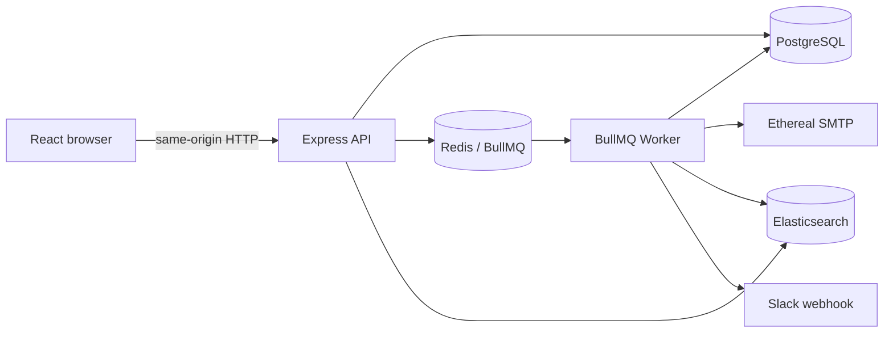

# ReachInbox Email Scheduler

A production-oriented full-stack email scheduler built as a strict TypeScript pnpm monorepo. Users authenticate with Google, upload CSV/TXT leads, schedule campaigns from configured Ethereal identities, monitor Scheduled/Sent/Failed mail, search through Elasticsearch, and optionally connect Slack for rate-limit alerts.

## Architecture



- PostgreSQL is authoritative business state.
- Redis/BullMQ holds distributed execution state, delays, rate permits, OAuth/session state, and alert deduplication.
- Elasticsearch is an eventually consistent, fully rebuildable email-search projection.
- `apps/api` and `apps/worker` are separate processes. In production, Express also serves the built React SPA from `apps/web/dist`.
- `packages/shared` contains browser-safe contracts; backend-only Elasticsearch and Slack code live in `packages/search` and `packages/slack`.

## Features

- Google OIDC login with Redis sessions, state/nonce validation, and tenant-scoped APIs
- automatic per-user provisioning of two configured Ethereal senders after login
- CSV/TXT lead parsing, normalization, deduplication, and bulk campaign scheduling
- user-scoped request idempotency and deterministic BullMQ job IDs
- separate Worker with atomic `SCHEDULED -> PROCESSING -> SENT | FAILED` claims
- distributed per-sender delay and hourly limits using Redis Lua
- startup/manual PostgreSQL-to-queue reconciliation
- Ethereal delivery previews and durable delivery metadata
- Elasticsearch projection, tenant-scoped search, safe initialization, and batched reindex
- Slack OAuth V2, encrypted secrets, and cross-worker rate-limit alert deduplication
- responsive React dashboard, Compose flow, read-only email detail, and authenticated Bull Board

## Technology

Node.js 22.16.0, pnpm 10.15.1, TypeScript, Express, React, Vite, Tailwind CSS, Prisma/PostgreSQL, BullMQ/Redis, Elasticsearch, Nodemailer/Ethereal, Vitest, React Testing Library, and Supertest.

## Repository structure

```text
apps/api       Express API, auth, scheduling, reads, Bull Board, SPA serving
apps/worker    BullMQ processing, limiter, SMTP, reconciliation, projections
apps/web       React/Vite browser application
packages/*     shared contracts plus backend-only search and Slack packages
prisma         schema, migrations, and PostgreSQL integration tests
scripts        test-database and operational helpers
context        assignment, architecture, references, and feature records
```

## Local setup

Prerequisites: Node.js 22.16.0, Corepack/pnpm, and Docker Compose v2.

```bash
corepack enable
pnpm install
cp .env.example .env
pnpm infra:up
pnpm db:migrate
pnpm search:init
```

Configure Google and both Ethereal accounts before starting the API. Slack is optional and must be either fully configured or entirely omitted.

Run each application in its own terminal:

```bash
pnpm dev:api
pnpm dev:worker
pnpm dev:web
```

Or run all three with `pnpm dev`. Vite serves the frontend at `http://localhost:5173` and proxies relative `/api` and `/admin` requests to Express at `http://localhost:4000`. Production uses one Express origin instead.

Useful local endpoints:

- web: `http://localhost:5173`
- health: `http://localhost:4000/api/health`
- Google login: `http://localhost:4000/api/v1/auth/google`
- Bull Board: `http://localhost:4000/admin/queues` (authentication required)

Infrastructure commands:

```bash
pnpm infra:up
pnpm infra:logs
pnpm infra:down
```

Normal shutdown preserves Docker volumes. `docker compose down --volumes` removes local data and should be used only intentionally.

## Environment

Copy `.env.example`; never commit real credentials. The main groups are:

- application: `NODE_ENV`, `HOST`, `PORT`, `LOG_LEVEL`, `FRONTEND_URL`
- persistence: `DATABASE_URL`, `TEST_DATABASE_URL`, `REDIS_URL`
- search: `ELASTICSEARCH_URL`, optional `ELASTICSEARCH_API_KEY`
- security: independent high-entropy `SESSION_SECRET` and `APP_ENCRYPTION_KEY`
- Google: `GOOGLE_CLIENT_ID`, `GOOGLE_CLIENT_SECRET`, `GOOGLE_CALLBACK_URL`
- Slack: `SLACK_CLIENT_ID`, `SLACK_CLIENT_SECRET`, `SLACK_CALLBACK_URL`
- SMTP: two `ETHEREAL_SENDER_*_USER/PASS` pairs
- Worker limits: `WORKER_CONCURRENCY`, `MIN_SEND_DELAY_MS`, `MAX_EMAILS_PER_HOUR_PER_SENDER`

The API uses the two Ethereal usernames to provision safe Sender rows. Only the Worker reads SMTP passwords. Passwords, Slack tokens, and webhook URLs are never returned to the browser; Slack secrets are encrypted at rest.

## Provider setup

### Google

Create a Google OAuth Web application with consent scopes `openid email profile`. Add this exact local redirect URI:

```text
http://localhost:4000/api/v1/auth/google/callback
```

Set its client ID/secret and callback URL in `.env`. In production, add and configure:

```text
https://<render-web-host>/api/v1/auth/google/callback
```

### Slack

Create a modern Slack app, enable Incoming Webhooks, and request only `incoming-webhook`. Add this local redirect URI:

```text
http://localhost:4000/api/v1/integrations/slack/callback
```

Configure the Slack client ID, secret, callback, and `APP_ENCRYPTION_KEY`. In production update both Slack and the environment to:

```text
https://<render-web-host>/api/v1/integrations/slack/callback
```

### Ethereal

Create two stable accounts at [ethereal.email](https://ethereal.email/) and configure both username/password pairs. On every successful Google login, the API idempotently ensures those usernames exist as active Senders owned by that user; no Prisma Studio step is needed. Existing manual senders remain intact.

## Operational commands

```bash
pnpm prisma:validate
pnpm prisma:generate
pnpm db:migrate             # local migration development
pnpm db:migrate:deploy      # production migration history
pnpm search:init            # non-destructive index creation
pnpm search:reindex         # bounded Postgres -> Elasticsearch repair
pnpm reconcile:queue -- --dry-run
pnpm reconcile:queue
pnpm verify:ethereal
```

`search:init` creates the canonical mapping only when absent; it does not delete an existing index. Reindex is a recovery/manual operation, not a normal restart requirement.

## Scheduling and delivery

The authenticated Compose route submits multipart data to `POST /api/v1/campaigns` with an `Idempotency-Key`. PostgreSQL transactionally creates the Campaign and ordered Email rows before BullMQ insertion. Identical retries reuse the campaign and repair missing jobs; conflicting payload reuse returns `409`.

The Worker reserves the distributed sender permit before claiming a row. Denied work stays `SCHEDULED`, retains `originalScheduledAt`, moves `scheduledAt`, and returns to BullMQ delayed state without sleeping a Worker. A conditional PostgreSQL update ensures only one Worker can claim `SCHEDULED -> PROCESSING`.

Startup reconciliation restores missing queue work from authoritative `SCHEDULED` rows. It never requeues `PROCESSING`, `SENT`, or `FAILED` rows. Elasticsearch and Slack execute after durable business decisions; failures in either are logged and cannot fail or retry SMTP.

## Tests and quality

Start local infrastructure, then run:

```bash
pnpm lint
pnpm typecheck
pnpm test:run
pnpm build
pnpm format:check
```

Focused suites are available as `pnpm test:db`, `pnpm test:queue`, `pnpm test:scheduling`, `pnpm test:worker`, `pnpm test:search`, and `pnpm test:slack`. Integration tests use the isolated `TEST_DATABASE_URL`; guardrails reject the normal development database.

## Production deployment

The intended topology is Render PostgreSQL, Upstash Redis, Elastic Cloud, one Render Web Service, and one Render Background Worker.

### Exact commands

Render build command:

```bash
pnpm install --frozen-lockfile && pnpm build
```

Render Web Service start command:

```bash
pnpm start:web
```

Render Background Worker start command:

```bash
pnpm start:worker
```

Run production migrations once per release:

```bash
pnpm db:migrate:deploy
```

Initialize search once (and safely on later releases):

```bash
pnpm search:init
```

Repair the projection only when required:

```bash
pnpm search:reindex
```

### Deployment checklist

1. Create Render PostgreSQL and set its internal `DATABASE_URL` on both services.
2. Create Upstash Redis with a TLS `rediss://` TCP endpoint and set `REDIS_URL` on both services.
3. Create Elastic Cloud, then set `ELASTICSEARCH_URL` and `ELASTICSEARCH_API_KEY` on both services.
4. Create the Render Web Service using the build/start commands above. Render supplies `PORT`; keep `HOST=0.0.0.0` and set `FRONTEND_URL=https://<render-web-host>`.
5. Run `pnpm db:migrate:deploy` against production PostgreSQL.
6. Run `pnpm search:init` against the production Elasticsearch endpoint.
7. Create the Render Background Worker using the same repository/build and `pnpm start:worker`; it does not expose an HTTP port.
8. Add the deployed Google callback to Google Cloud and set the matching environment URL.
9. Add the deployed Slack callback to the Slack app and set the matching environment URL.
10. Sign in and smoke-test sender availability, scheduling, delivery, search, Slack, direct SPA-route refresh, logout, and authenticated Bull Board access.

The Web Service trusts exactly one reverse-proxy hop in production so secure session cookies work behind Render TLS termination. Cookies are `HttpOnly`, `Secure` in production, and `SameSite=Lax`. The browser uses relative same-origin URLs; no production CORS exception or hardcoded host is required.

Upstash must expose Redis protocol/TLS and Lua `EVAL`, and BullMQ uses `maxRetriesPerRequest: null` for Worker connections. Rate-limit keys retain their sender hash tags. Elastic Cloud API-key authentication is supported; Docker-local security assumptions are not used in production.

## Trade-offs and known limitations

- BullMQ custom job IDs make queue insertion idempotent while a job exists, but do not provide exactly-once SMTP delivery.
- Atomic `SCHEDULED -> PROCESSING` claims protect against duplicate concurrent attempts.
- SMTP acceptance has an unavoidable crash/acknowledgement ambiguity. Ambiguous mail remains `PROCESSING` and is not automatically retried, favoring duplicate avoidance.
- Rate permits are reservations made before SMTP; failures and rare claim races are not refunded, conservatively underusing capacity rather than exceeding it.
- Slack and Elasticsearch are best-effort side effects and cannot change the durable delivery outcome.
- Elasticsearch may briefly lag PostgreSQL and is repaired through idempotent reindexing.
- Startup reconciliation repairs PostgreSQL-to-queue gaps, not ambiguous SMTP outcomes.
- Bull Board is session-authenticated but has no separate administrator role in this assignment.
- Sender provisioning reflects configured identities. Changing a username adds a new Sender but does not automatically deactivate historical rows.
- Deployment is intentionally manual; no CI/CD or container orchestration is included.
